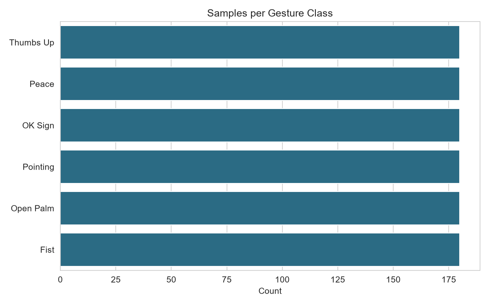
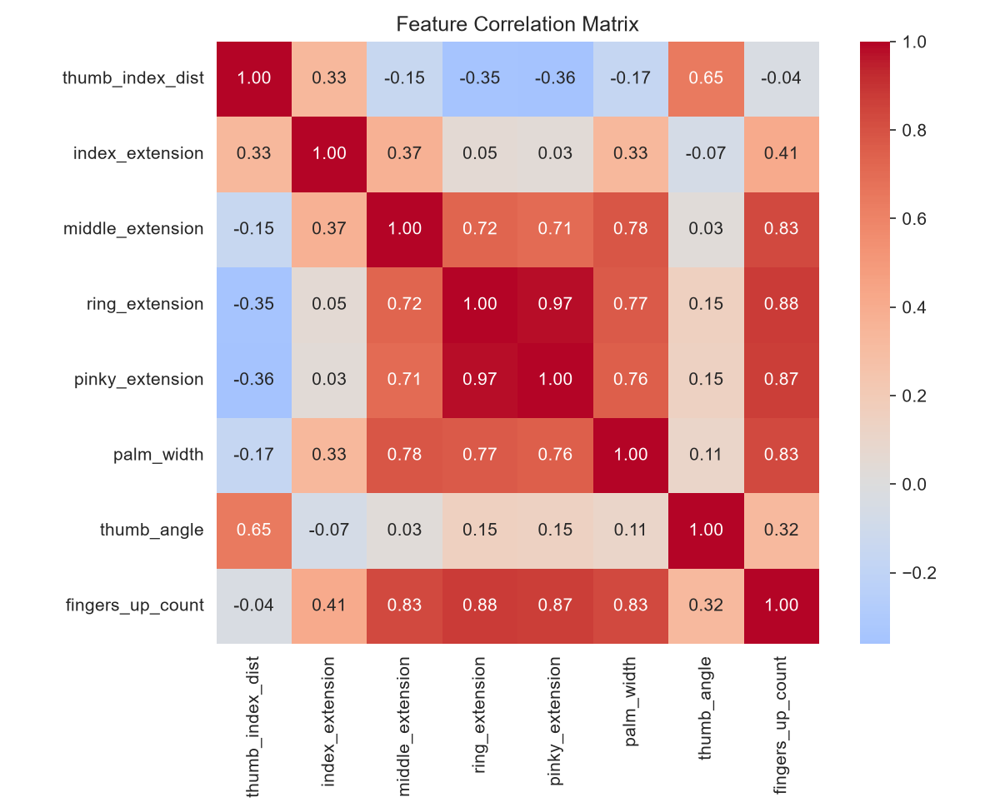
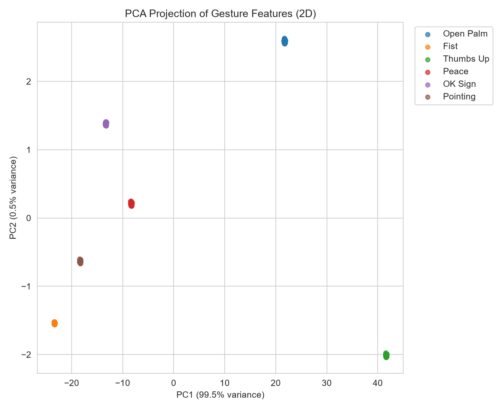
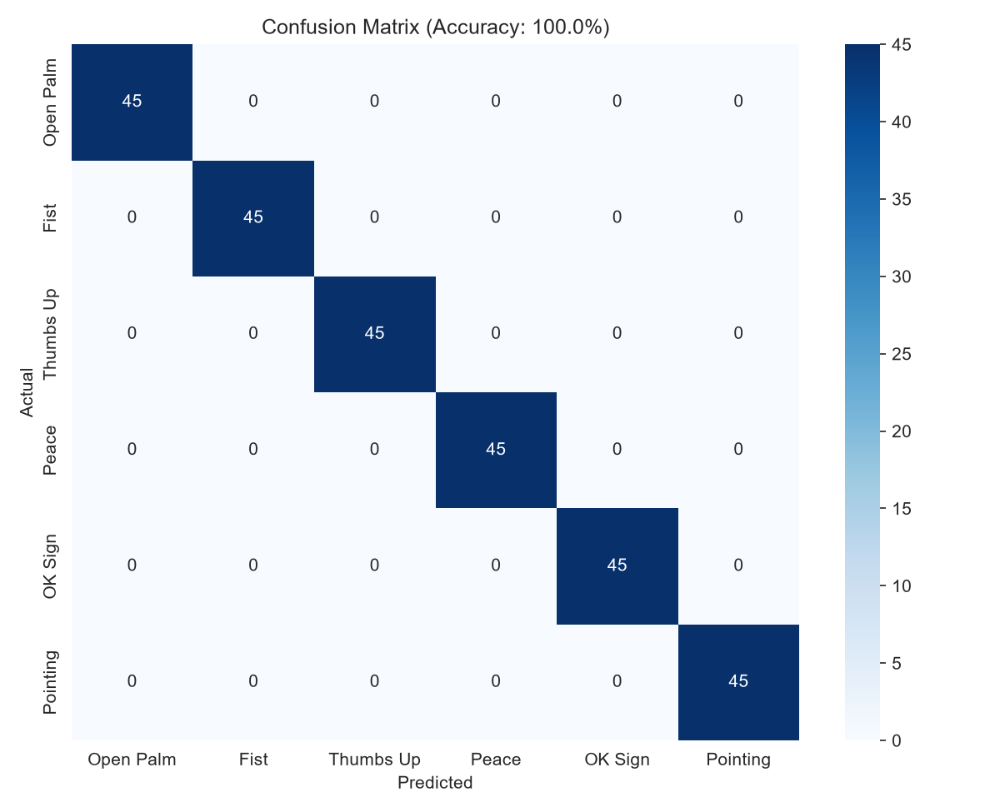
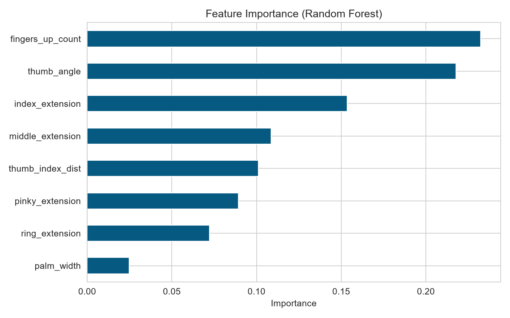

# Hand Gesture Recognition using Machine Learning

A real-time hand gesture recognition system built with **Python, OpenCV, MediaPipe and scikit-learn**. It detects hand landmarks from a webcam, converts them into a small set of geometric features, and classifies the gesture with a Random Forest model.

This was my final seminar project for MSc IT (Data Analysis).

## Gestures recognised

Open Palm, Fist, Thumbs Up, Peace, OK Sign, Pointing (works with one or both hands).

## How it works

1. **Hand detection** – MediaPipe finds 21 landmarks on each hand in every webcam frame.
2. **Feature extraction** – 8 scale-normalised features are computed from the landmarks (`feature_extraction.py`):
   thumb–index distance, index/middle/ring/pinky extension, palm width, thumb angle, and number of fingers up.
   Distances are divided by the wrist-to-middle-knuckle length, so results don't depend much on how far the hand is from the camera.
3. **Classification** – a Random Forest (scikit-learn) is trained on the collected dataset.
4. **Live prediction** – predictions with confidence below 0.65 are marked "Uncertain", and a 7-frame majority vote smooths out flicker.

## Results

- Dataset: 6,000 samples (1,000 per gesture), collected by me with a webcam
- Split: 80% train / 20% test (stratified)
- Test accuracy: **99.83%**

## Project structure

## Analysis and visualisations

The EDA pipeline (`gesture_data_analysis.py`) produces these charts on a demonstration dataset:

| Class distribution | Feature correlation |
|---|---|
|  |  |

| PCA projection | Confusion matrix |
|---|---|
|  |  |



| File | Purpose |
|---|---|
| `camera_test.py` | Checks that the webcam and OpenCV work |
| `feature_extraction.py` | Turns MediaPipe landmarks into the 8 features |
| `collect_data.py` | Records labelled samples into `gesture_data.csv` |
| `train_model.py` | Trains and evaluates the Random Forest, saves `gesture_model.pkl` |
| `live_gesture_demo.py` | Real-time webcam demo |
| `gesture_data_analysis.py` | EDA and visualisation pipeline (class balance, correlation heatmap, PCA, confusion matrix, feature importance). Uses a **synthetic** dataset for demonstration |
| `gesture_data.csv` | The collected dataset |
| `gesture_model.pkl` | The trained model |

## Setup and usage

```bash
git clone https://github.com/minalsood24/hand-gesture-recognition.git
cd hand-gesture-recognition

python -m venv .venv
.venv\Scripts\activate        # Windows
# source .venv/bin/activate   # macOS / Linux

pip install -r requirements.txt
```

```bash
python camera_test.py           # 1. check the camera
python collect_data.py          # 2. (optional) collect your own data: press 1-6 to pick a gesture, Q to quit
python train_model.py           # 3. (optional) retrain the model
python live_gesture_demo.py     # 4. run the live demo, press Q to quit
```

The repo already contains a trained model and dataset, so you can jump straight to step 4.

## Limitations and future work

- Only static gestures; no motion-based gestures (swipe, wave).
- Data was collected by one person in similar lighting, so accuracy on other people and environments will likely be lower than the reported number. Testing with data from other people is the next step.
- Could be extended with more gestures, a neural-network classifier, or mapping gestures to actions (volume, slides, etc.).

## Tech stack

Python · OpenCV · MediaPipe · scikit-learn · pandas · NumPy · Matplotlib · Seaborn

## Author

**Minal Sood** – [GitHub](https://github.com/minalsood24) · [LinkedIn](https://linkedin.com/in/minal-sood24)
